# 月星BAS工具箱 1.1.1

月星BAS工具箱是一款面向 macOS 15 与 OpenCore 环境的本地权限和系统维护工具。
图形界面使用 PyQt6，权限扫描、数据库写入、备份和诊断保留完整的本地审计记录。

> 动态权限开关会在点击后立即修改用户级 `TCC.db`。每次切换都会自动备份并回读
> 验证，但不再弹出二次确认。命令行 `inject --execute` 仍要求交互确认。

## 核心能力

### 权限管理

- 扫描 `.app` 的 Bundle ID、版本、签名、Entitlements 和隐私用途声明。
- 支持摄像头、麦克风、Apple Events、桌面、文稿、下载和可移除卷。
- 读取用户级 TCC 状态：允许、拒绝、无记录或未知。
- 左侧应用、右侧权限的动态开关界面，立即写入允许或删除记录。
- 批量授权、受管理备份恢复、环境诊断和脱敏 JSON Lines 审计日志。
- 动态权限列表固定使用中文应用名，兼容 Apple 应用的 Spotlight 中文显示名。

### 系统维护

- 读取并清理 System Settings 更新红点，不阻断系统安全更新。
- 列出 EFI 分区，经用户确认和管理员授权后挂载或卸载。
- 在图形界面应用或还原谢清宇工作室 OpenCore 主题，支持自动备份与回滚。

## 系统要求

- macOS 15 或更高版本
- Python 3.11 或更高版本
- 当前打包版本为 `x86_64`，面向 Intel Mac

## 安装

### 从源码运行

```bash
python3.11 -m venv .venv
source .venv/bin/activate
python -m pip install --upgrade pip
python -m pip install -e ".[gui]"
```

### 使用打包应用

构建后的应用位于：

```text
dist/月星BAS工具箱.app
```

安装镜像位于：

```text
dist/月星BAS工具箱-1.1.1.dmg
```

将应用拖入“应用程序”后再启用登录启动。直接从 DMG 挂载卷运行时，登录启动
开关会保持禁用。

## 图形界面

```bash
yuexing-bas-gui
```

也可以运行：

```bash
python -m tcc_permission_assistant.app
```

左侧导航：

```text
工具箱
├── 权限管理
│   ├── 扫描
│   ├── 批量
│   ├── 动态权限
│   ├── 恢复
│   ├── 诊断
│   └── 日志
├── 系统维护
│   ├── 更新提示
│   ├── EFI 分区
│   └── OC 主题
└── 设置
```

启动时先显示启动动画，完成已安装应用扫描后再打开主界面。启动扫描结果会直接
交给批量页和动态权限页，不重复扫描。

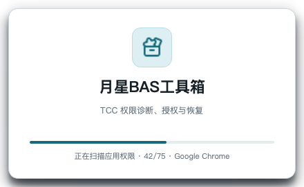

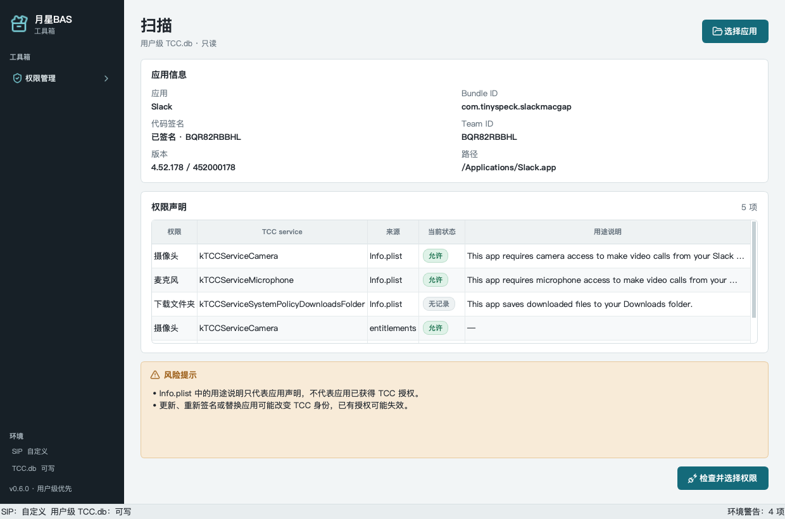

### 动态权限

“动态权限”页采用左右布局：

- 左侧列出应用，支持按中文名称或 Bundle ID 搜索；
- 应用名称采用中文优先解析，覆盖 Spotlight 和常用 Bundle ID；
- 右侧显示应用声明过的权限，以及 TCC 中已有记录的其他相关权限；
- 点亮开关立即写入允许；
- 关闭开关立即删除该应用对应 service 的全部用户级记录；
- 每次切换自动备份 TCC.db，并在事务提交后重新读取验证；
- 验证失败时自动回滚到操作前备份；
- 成功或失败状态显示在页面底部，不弹出确认框。

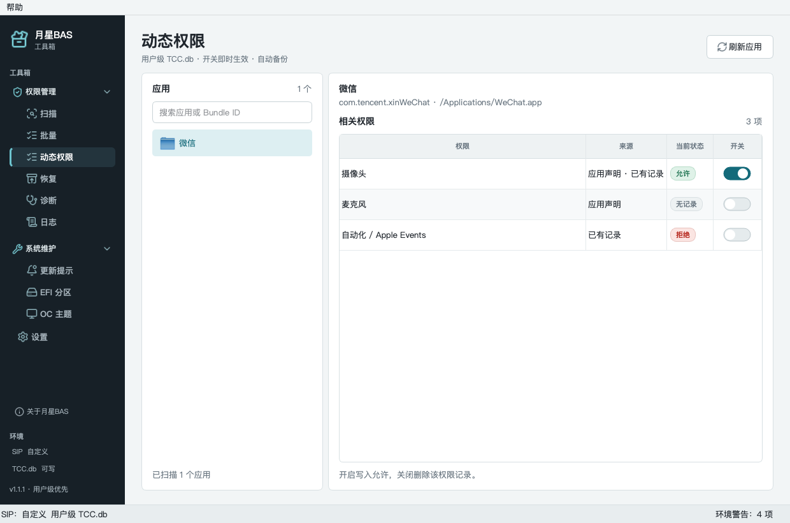

关闭开关执行数据库记录删除，不是写入 `auth_value = 0` 的拒绝状态。应用之后
重新请求权限时，macOS 仍可再次显示原生权限窗口。

Apple Events 可能包含多个目标应用记录。通用开关不会批量修改这些记录，多目标
场景必须使用逐目标接口。

### 批量授权

1. 多选要授予的 TCC 权限；
2. 只显示声明过所选权限的应用，默认不勾选；
3. 生成计划，默认 dry-run；执行时创建一个备份，并在单个事务中写入。

任一权限写入失败会回滚整批变更。Helper Bundle 不会进入批量候选列表。

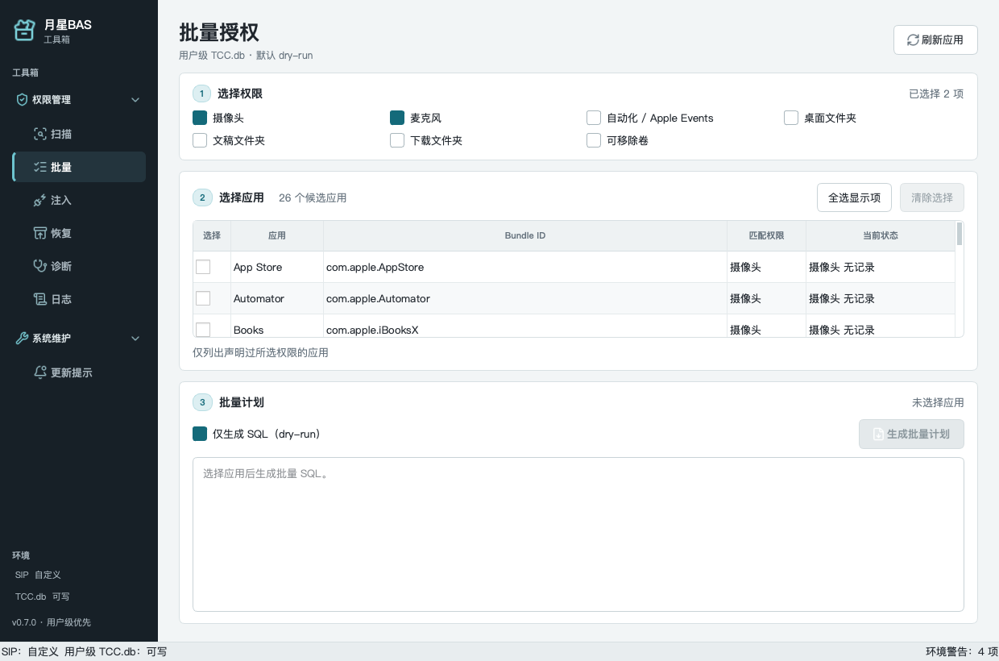

### 扫描

扫描页支持拖入或选择 `.app`，显示应用身份、签名、Team ID、权限声明和当前
TCC 状态。扫描始终只读。

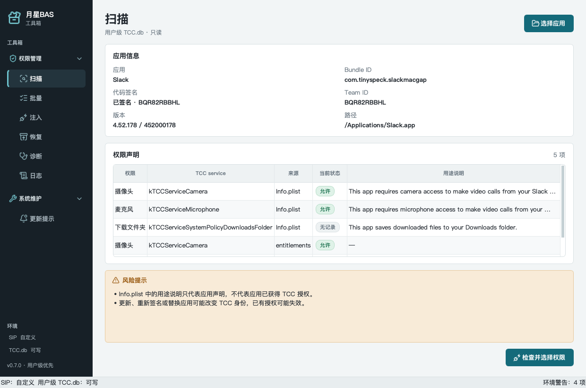

### 恢复

恢复页只接受工具管理目录中的备份。默认只预览计划；确认后先备份当前数据库，
再执行恢复并重新读取 schema。

### 诊断与日志

- 诊断 macOS 版本、SIP、boot-args、AMFI/AMFIPass 和两个 TCC.db。
- 导出 Markdown 或 JSON 报告。
- 日志页面查看脱敏审计事件，支持复制和清空。

## 系统维护

### 更新提示

更新红点页读取：

```text
~/Library/Preferences/com.apple.systempreferences.plist
```

中的 `AttentionPrefBundleIDs`，区分更新相关项和其他设置提示。修改前备份完整
偏好文件，写入后重新读取验证，并刷新 System Settings 与 Dock。

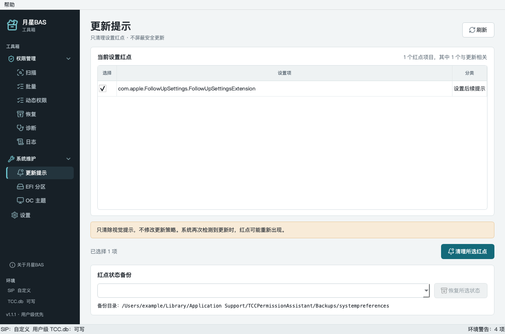

### EFI 分区

EFI 分区通过 `diskutil list -plist physical` 只读识别。挂载或卸载前会显示引导
风险、请求用户确认，再通过 `osascript` 获取管理员授权。

工具不会自动挂载 EFI，也不会自动修改 OpenCore 配置。

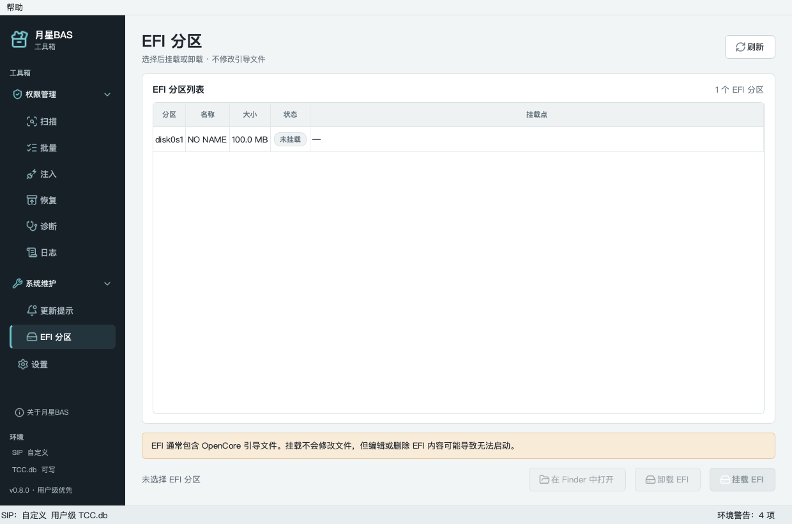

### OpenCore 主题

“系统维护 → OC 主题”提供谢清宇工作室 OpenCanopy 主题：

- 3840×2160 与 5120×2880 品牌背景；
- 27 个统一风格启动图标；
- 13 组中文启动标签；
- 自动发现已挂载的 `EFI/OC`，也支持手动选择目录；
- 应用前备份配置、标签、原主题和 OpenCanopy 驱动；
- 应用后执行 `plutil -lint`，失败时自动回滚；
- config.plist 与驱动使用 `fsync` 和原子替换写入；
- 应用前必须确认当前 OpenCore 与 OpenCanopy 驱动兼容；
- 从备份列表还原，并在还原前保存当前状态。

开源源码不附带 `OpenCanopy.efi`。首次应用前需从 OpenCore 官方发行包获取匹配
版本并放入 `oc_theme/OpenCanopy.efi`。

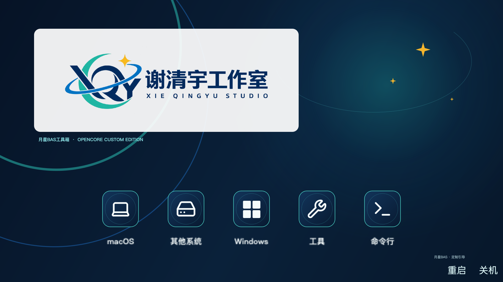

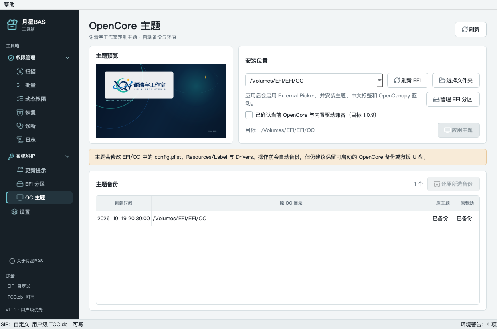

详细说明见 [oc_theme/README.md](oc_theme/README.md)。

## 设置

### 应用名称语言

“扫描”和“批量”页面可选择：

- 跟随系统；
- 简体中文；
- English。

动态权限页始终使用中文应用名，不受此设置影响。

### 登录启动与自动红点

登录启动使用用户级 LaunchAgent，无需管理员权限：

```text
~/Library/LaunchAgents/com.yuexing.bastoolbox.autostart.plist
```

自动红点清理在应用启动时检查一次，运行期间每 6 小时检查。只处理更新相关项，
没有可清理项目时不会重启 System Settings 或 Dock。

设置文件：

```text
~/Library/Application Support/TCCPermissionAssistant/settings.json
```

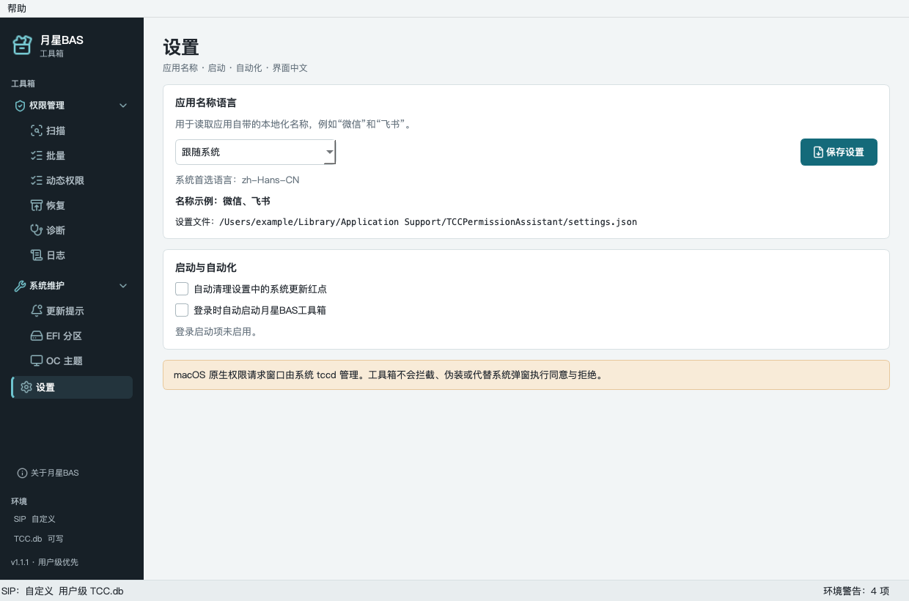

### 原生权限弹窗边界

macOS 原生权限请求窗口由受保护的 `tccd` 展示。第三方应用不能拦截、仿冒或代替
系统执行“同意”和“拒绝”。工具箱不会提供伪装成系统授权的界面。

## 命令行

### 扫描与诊断

```bash
yuexing-bas scan "/Applications/Google Chrome.app"
yuexing-bas scan "/Applications/Google Chrome.app" --json
yuexing-bas inspect-db
yuexing-bas inspect-db --client com.tencent.xinWeChat \
  --service Microphone --json
yuexing-bas diagnose --output report.md
yuexing-bas diagnose --advanced --output report.json
```

### 注入

```bash
yuexing-bas generate --bundle com.google.Chrome \
  --service Camera --allow
yuexing-bas inject --bundle com.google.Chrome \
  --service Camera --allow --dry-run
yuexing-bas inject --bundle com.google.Chrome \
  --service Camera --allow --execute
```

命令行写入流程：

1. 生成并展示参数化 SQL；
2. 显式添加 `--execute`；
3. 确认相关应用已完全退出；
4. 输入 `INJECT`；
5. 自动备份并在事务中写入；
6. 回读验证并输出备份路径与 SHA-256。

### 恢复

```bash
yuexing-bas restore --list
yuexing-bas restore --file "/path/to/TCC-user-xxxx.bak"
yuexing-bas restore --file "/path/to/TCC-user-xxxx.bak" --execute
```

旧命令 `tcc-assistant` 和 `tcc-assistant-gui` 继续作为兼容别名保留。

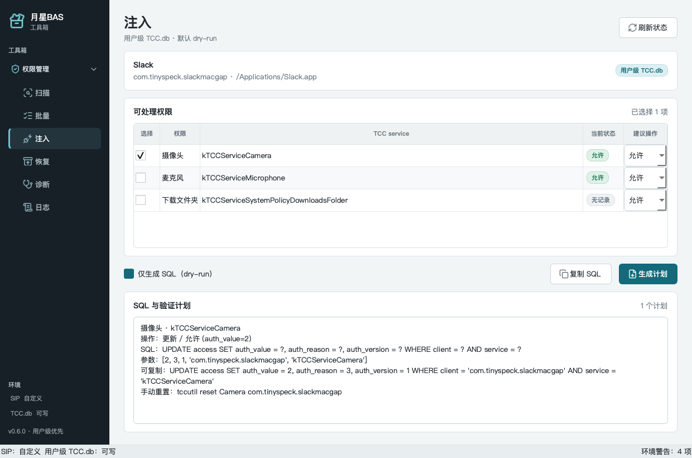

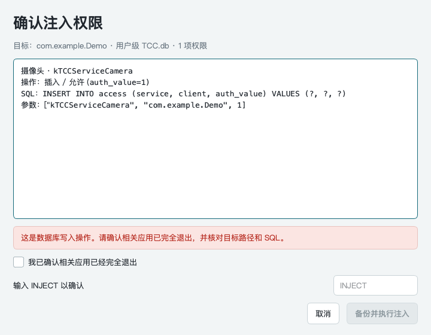

## 数据路径

备份：

```text
~/Library/Application Support/TCCPermissionAssistant/Backups/user/
```

审计日志：

```text
~/Library/Application Support/TCCPermissionAssistant/Logs/audit.log
```

备份目录权限为 `0700`，文件权限为 `0600`。日志不记录权限用途说明、个人文件
内容、管理员密码或令牌。

## 关于

- 开发者：谢清宇@谢清宇工作室
- Bundle ID：`com.yuexing.bastoolbox`
- 分类：Utilities

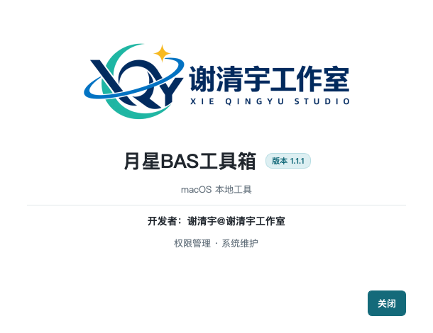

## macOS 打包

```bash
./build_macos.sh
```

输出：

```text
dist/月星BAS工具箱.app
dist/月星BAS工具箱-1.1.1.dmg
```

`.app` 包含 Python 3.11、PyQt6、Qt 依赖、应用图标和工作室 Logo。构建脚本会
写入产品身份、执行 ad-hoc 签名并运行 `codesign --verify`。

未使用 Apple Developer ID 时无法完成 Apple 公证，Gatekeeper 首次启动可能提示
来源未知。可在 Finder 中右键应用选择“打开”。

## 更新日志

完整版本记录见 [CHANGELOG.md](CHANGELOG.md)。

## 开源目录与上传范围

应上传到代码仓库的目录：

```text
tcc_permission_assistant/
packaging/
oc_theme/
docs/screenshots/
```

同时上传根目录文件：

```text
README.md
CHANGELOG.md
.gitignore
pyproject.toml
requirements.txt
build_macos.sh
SECURITY.md
THIRD_PARTY_NOTICES.md
BRAND_ASSETS.md
LICENSE
LICENSES/
```

开源目录不包含 `tests/`、`.venv/`、`build/`、`dist/`、`.run/`、缓存、
DMG、编译应用或任何个人路径。

## 安全边界

- 仅在用户确认后修改 OpenCore `config.plist`，并先备份、校验和自动回滚。
- 不提供任意 TCC service 名称。
- 不调用 shell，所有子进程使用参数列表。
- 扫描、生成和诊断默认只读。
- 写入仅限用户级数据库。
- GUI 动态开关不弹确认，但每次自动备份并回读验证。
- 写入后验证失败会自动恢复到本次操作前备份。
- Apple Events 不再允许通过单开关批量修改多个目标。
- 命令行写入和数据库恢复必须完成人工确认。
- 系统级数据库注入不可用；系统级恢复必须获取管理员授权。
- 不拦截、仿冒或代替 macOS `tccd` 原生权限窗口。

## 免责声明

直接修改 TCC 数据库可能受 macOS 版本、SIP、AMFI、应用签名和数据库 schema
影响。错误操作可能破坏隐私权限状态。使用动态权限开关前应确认当前应用和权限
行；需要恢复时优先使用工具管理的历史备份。

本项目不绕过应用授权、付费、版权保护或管理员密码。

## 许可证状态

本项目采用 **GNU General Public License v3.0 only**，完整许可证见根目录
`LICENSE`。

项目使用 PyQt6。公开分发 PyQt6 应用通常需要采用 GPLv3，或从 Riverbank 获取
商业许可。本仓库使用 GPLv3 路线。

第三方组件和品牌资产说明见：

- `THIRD_PARTY_NOTICES.md`
- `BRAND_ASSETS.md`
